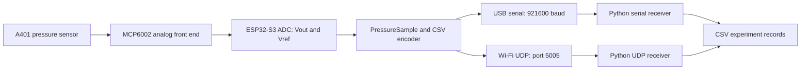
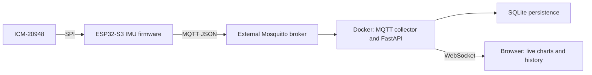

# ESP32-S3 Sensor Data Acquisition for CPR Research

**Embedded C++ | Analog Sensing | USB / Wi-Fi UDP | Python | Docker | FastAPI**

A research prototype for collecting pressure and inertial signals as the foundation for future CPR quality assessment. The project connects MCU firmware, sensor interfacing, PC data capture, and a previous web monitoring prototype in one repository.

The current firmware focuses on **A401 pressure sensor acquisition through an MCP6002 analog front end**, with a **100 Hz sampling target** and interchangeable USB serial and Wi-Fi UDP output. ICM-20948 acquisition and MQTT visualization belong to an earlier iteration; synchronized sensor fusion and TinyML inference are the next research milestones.

## Motivation

My master's research direction is to combine flexible pressure sensing and IMU data with real-time signal processing, feature extraction, and MCU-deployed TinyML for CPR quality feedback. Before training a model, the system needs a repeatable way to acquire signals, inspect sensor behavior, and save experimental records.

This repository implements that acquisition foundation. It demonstrates work across analog sensor interfacing, embedded firmware, network transport, Python tooling, and web-based telemetry.

## Engineering Highlights

- **One acquisition path, two transports.** A shared `PressureSample` record and CSV encoder feed USB serial or Wi-Fi UDP, selected through PlatformIO build environments. See [firmware](src/main.cpp) and [build configuration](platformio.ini).
- **Analog signal visibility.** The firmware reports both sensor output and buffered reference voltage, alongside their difference, to support pressure-circuit investigation.
- **PC capture tools.** Python receivers validate the six-column format, skip diagnostic lines, and persist samples to CSV for later analysis. See [serial capture](tools/serial_to_csv.py) and [UDP capture](tools/udp_to_csv.py).
- **Earlier telemetry implementation.** A Dockerized MQTT subscriber stores accelerometer and gyroscope records in SQLite and serves a FastAPI / WebSocket GUI with live charts and recent records. See [collector GUI](collector_gui/README.md).

## System Architecture

Current pressure acquisition path:



<details>
<summary>Earlier IMU / MQTT monitoring path</summary>



The compatible IMU publisher is preserved on the [try_SPI branch](https://github.com/Darren-HUNGITAI/esp32s3_icm20948_mqtt_demo/tree/try_SPI). The current pressure firmware does not publish MQTT, and the collector does not consume pressure CSV. The Mosquitto broker is configured separately from this repository.

</details>

## Implementation Status

| Capability | Status |
| --- | --- |
| A401 / MCP6002 acquisition with ESP32-S3 internal ADC | Implemented in current firmware |
| USB serial and Wi-Fi UDP CSV output | Implemented as separate build environments |
| Python serial / UDP capture to CSV | Implemented |
| ICM-20948 SPI acquisition and MQTT publishing | Earlier firmware iteration |
| Docker, SQLite, REST API, and WebSocket GUI | Implemented for the earlier MQTT pipeline |
| Synchronized pressure + IMU sampling and feature extraction | Planned |
| TinyML training, quantization, and on-device inference | Planned |
| CPR quality accuracy, latency, and power evaluation | Planned |

## Quick Start

Requirements: PlatformIO, Python with `pip`, an ESP32-S3 N16R8, and the pressure circuit described below. The commands use PowerShell.

```powershell
git clone https://github.com/Darren-HUNGITAI/esp32s3_icm20948_mqtt_demo.git
cd esp32s3_icm20948_mqtt_demo
python -m pip install -r tools\requirements.txt
```

### USB Serial Capture

Build and upload the default firmware:

```powershell
platformio run -e esp32s3_n16r8
platformio run -e esp32s3_n16r8 --target upload
```

Find the serial port and save an experiment, replacing `COM6` with the board's port:

```powershell
python tools\serial_to_csv.py --list-ports
python tools\serial_to_csv.py --port COM6 --out data\trial_001.csv
```

Stop capture with `Ctrl+C`. To inspect output without saving a file, use `platformio device monitor --baud 921600`. Close the serial monitor before running the capture script; both need the same serial port.

### Wi-Fi UDP Capture

1. Copy the configuration template:

   ```powershell
   Copy-Item include\secrets.example.h include\secrets.h
   ```

2. Set `WIFI_SSID`, `WIFI_PASSWORD`, and `UDP_TARGET_IP` in `include/secrets.h`. Use a reachable 2.4 GHz Wi-Fi network and the PC's LAN IPv4 address from `ipconfig`.
3. Start the receiver on the PC:

   ```powershell
   python tools\udp_to_csv.py --port 5005 --out data\udp_trial_001.csv --quiet
   ```

4. In another terminal, build and upload the UDP firmware:

   ```powershell
   platformio run -e esp32s3_n16r8_udp
   platformio run -e esp32s3_n16r8_udp --target upload
   ```

Allow inbound UDP port `5005` on the PC for this experiment network when required by Windows Firewall. The receiver must already be running to capture the initial packets. Wi-Fi credentials, generated CSV files, and local SQLite data are excluded from Git.

## Data Contract

Both transports use the same CSV header:

```text
uptime_ms,pressure_vout_raw,pressure_vout_mv,pressure_vref_raw,pressure_vref_mv,pressure_delta_mv
```

| Field | Meaning | Unit |
| --- | --- | --- |
| `uptime_ms` | MCU uptime at the start of acquisition | ms |
| `pressure_vout_raw` | Pressure amplifier output ADC count | 12-bit ADC counts |
| `pressure_vout_mv` | Pressure amplifier output voltage | mV |
| `pressure_vref_raw` | Buffered reference ADC count | 12-bit ADC counts |
| `pressure_vref_mv` | Buffered reference voltage | mV |
| `pressure_delta_mv` | Output voltage minus reference voltage | mV |

The firmware checks a `10000 us` interval in its main loop. This is a **sampling target**, not a measured timing guarantee. Diagnostic lines begin with `#`; the capture scripts skip these lines and repeated CSV headers.

Raw counts and millivolts come from separate ADC calls. The voltage difference is a pressure trend signal, not a calibrated force or compression-depth measurement. Start a new trial after MCU reboot because `uptime_ms` restarts.

## Hardware Setup

| Component | Role |
| --- | --- |
| ESP32-S3 N16R8 | MCU; configured for 16 MB flash and 8 MB OPI PSRAM |
| A401 pressure sensor | Pressure-sensitive input |
| MCP6002-I/P | Reference buffer and pressure analog front end |
| 47k / 10k resistors and 100nF capacitors | Reference divider, feedback, and decoupling |
| ICM-20948 | IMU used in the earlier SPI / MQTT iteration; inactive in current firmware |

<details>
<summary>A401 / MCP6002 wiring</summary>

| MCP6002 pin | Connection |
| --- | --- |
| 1 OUTA | `VREF_BUF`, also ESP32-S3 GPIO2 |
| 2 -INA | Pin 1 OUTA |
| 3 +INA | Divider midpoint `VREF_RAW` |
| 4 VSS | GND |
| 5 +INB | `VREF_BUF` |
| 6 -INB | A401 signal node and feedback resistor |
| 7 OUTB | `VOUT_PRESSURE`, also ESP32-S3 GPIO1 |
| 8 VDD | 3V3 |

| Part | Connection |
| --- | --- |
| 47k divider resistor | 3V3 to `VREF_RAW` |
| 10k divider resistor | `VREF_RAW` to GND |
| 100nF capacitor | `VREF_RAW` to GND |
| 100nF decoupling capacitor | MCP6002 pin 8 to GND, close to the IC |
| A401 | MCP6002 pin 6 to GND |
| 47k feedback resistor | MCP6002 pin 7 to pin 6 |

The divider gives a nominal reference of about `0.58 V` with a `3.3 V` supply. Inspect output and reference together when checking circuit behavior. Keep the ADC inputs within the ESP32-S3's supported voltage range.

</details>

<details>
<summary>ICM-20948 SPI wiring from the earlier prototype</summary>

| ESP32-S3 | ICM-20948 |
| --- | --- |
| GPIO10 | NCS |
| GPIO11 | SDA / MOSI |
| GPIO12 | SCL / SCLK |
| GPIO13 | AD0 / MISO |
| 3V3 | VCC |
| GND | GND |

On the module used here, SPI shares the I2C-labeled pins. Leave `EDA`, `ECL`, `INT`, and `FSYNC` disconnected for the earlier firmware wiring. DMP support was not enabled in that prototype.

</details>

## Repository Guide

| Location | Purpose |
| --- | --- |
| [src/main.cpp](src/main.cpp) | Pressure sampling, CSV encoding, and transport selection |
| [platformio.ini](platformio.ini) | USB / UDP environments and N16R8 memory configuration |
| [include/secrets.example.h](include/secrets.example.h) | Wi-Fi / UDP configuration template |
| [tools/](tools/) | Python experiment capture scripts |
| [collector_gui/](collector_gui/README.md) | Earlier MQTT / SQLite / web monitoring prototype |
| [lib/SparkFun_ICM20948/](lib/SparkFun_ICM20948/) | Vendored SparkFun IMU driver for the earlier prototype |

## Validation and Next Milestones

The default USB firmware has passed a PlatformIO build, and the Python capture scripts have passed syntax checks. These checks establish buildability; they do not establish sensor accuracy or wireless delivery performance. Hardware characterization and a labeled dataset remain necessary before model evaluation.

- Characterize pressure response, baseline drift, and repeatability against a reference measurement.
- Reintroduce synchronized accelerometer / gyroscope acquisition with sample sequence numbers and trial metadata.
- Measure sampling jitter, UDP packet loss, end-to-end latency, and power consumption under consistent conditions. The current UDP sender has no acknowledgment or retransmission, and Wi-Fi sleep is disabled.
- Develop labeling and feature extraction, then train and evaluate a quantized TinyML model on the MCU.

## Resume Description

**English**

> Developed an ESP32-S3 sensor acquisition prototype for CPR research with A401 / MCP6002 analog pressure sensing, a 100 Hz sampling target, USB serial and Wi-Fi UDP transports, and Python CSV capture tools. Built an earlier ICM-20948 telemetry pipeline with MQTT, Docker, SQLite, FastAPI, and WebSocket visualization.

**Traditional Chinese**

> 開發用於 CPR 研究的 ESP32-S3 感測資料擷取原型，整合 A401／MCP6002 類比壓力感測、以 100 Hz 為目標的取樣排程、USB Serial／Wi-Fi UDP 傳輸與 Python CSV 紀錄工具；另於前期原型完成 ICM-20948、MQTT、Docker、SQLite、FastAPI 與 WebSocket 即時視覺化資料管線。

TinyML inference, clinical performance, and measured latency / power improvements are future work and are not claimed as completed results.
